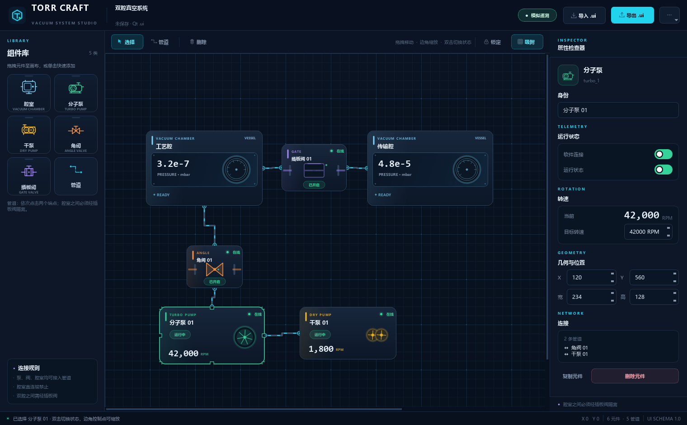
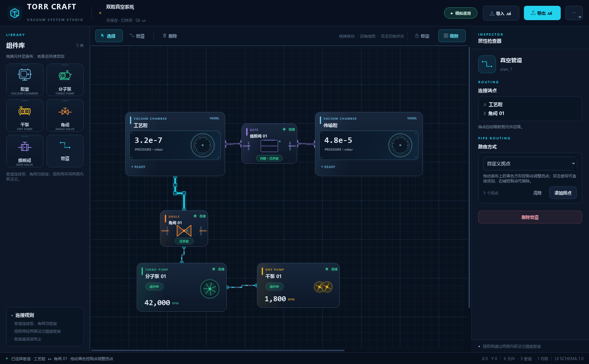

# Torr Craft

基于 **PySide2 / Qt 5.15** 的真空系统监控低代码平台。用拖拽方式组态分子泵、干泵、角阀、插板阀、腔室与管道，实时显示开关、软件连接、转速与压力，并能把整张图纸导出为 Qt Designer 可解析的 `.ui` 文件。

插板阀按真实设备建模为**两个腔室之间的内联法兰**：`腔室 — 插板阀 — 腔室` 直接贴装，不需要管道；画布上使用带螺栓/波纹段的法兰连接样式区分于管道。



## 已实现的需求

| # | 需求 | 实现 |
|---|---|---|
| 1 | 六类主要元素 | 腔室、分子泵、干泵、角阀、插板阀、管道 |
| 2 | 管道连接泵/阀/腔室 | 分子泵、干泵、角阀、腔室可接入管道；支持自动正交、直线、自定义拐点；插板阀不接管道 |
| 3 | 双腔之间必须用插板阀隔离 | 插板阀通过两侧内联法兰绑定两个腔室，形成 `腔室 — 插板阀 — 腔室` 无管道贴装 |
| 4 | 五类实体元件可调整大小 | 选中后拖动 8 个控制点，或在属性检查器中精确输入宽高 |
| 5 | 开关状态 + 软件连接状态 | 泵/阀显示“在线/离线”与“运行中/已停止”或“已开启/已关闭”，双击或检查器可切换 |
| 6 | 分子泵、干泵显示转速 | 当前转速大号数字显示，带升速/降速仿真 |
| 7 | 导入/导出 Qt `.ui` | 完整的 Qt UI XML 读写；`pyside2-uic` 可正常编译导出的文件 |

此外还包含：

- 深色工业风编辑器、可拖拽组件库、画布网格与 10 px 吸附
- 单对象属性检查器、连接关系提示、工程脏状态跟踪
- 插板阀两侧法兰下拉选择、自动贴装相邻腔室、法兰数量状态显示
- 管道自动正交 / 直线 / 自定义拐点三种路由；拐点可拖动、添加、删除
- 本地模拟遥测、运行状态联动（泵/阀关闭时管道流动动画停止）
- 新建、示例工程、另存为、打开、未保存确认
- 画布锁定模式，便于演示时防止误移动

## 快速开始

要求 Python 3.9（PySide2 5.15 目前没有 Python 3.11+ 的官方 wheel）和 PySide2 5.15.2。

```powershell
python -m pip install -r requirements.txt
python run.py
```

也可以：

```powershell
python -m torr_craft
```

首次启动会载入“**双腔真空系统**”示例。按 `Ctrl+N` 新建空白图纸。

### 常用快捷键

| 快捷键 | 操作 |
|---|---|
| `Ctrl+N` | 新建图纸 |
| `Ctrl+O` | 打开 / 导入 `.ui` |
| `Ctrl+S` | 保存；首次保存会询问路径 |
| `Ctrl+Shift+S` | 另存为 / 导出 `.ui` |
| `Ctrl+L` | 锁定 / 解锁画布 |
| `Ctrl+G` | 开关网格吸附 |
| `Esc` | 取消管道起点或退出管道模式 |
| `Delete` | 删除当前选中的元件或管道（画布获得焦点时） |

### 画布操作

- 从左侧组件库 **拖拽** 元件到画布，或在组件库卡片上 **单击** 快速添加。
- 单击元件选中；拖动主体移动；拖动 8 个角/边控制点缩放。
- 按住 `Alt` 拖动可临时关闭网格吸附。
- 双击泵/阀门切换运行状态或阀门开关。
- 点击工具栏“管道”或组件库“管道”，依次点击两个端点建立连接。
- 选中管道后，在检查器“路由方式”中选择 **自动正交 / 直线 / 自定义拐点**。
- 自定义拐点模式下，画布上的青色方形控制点可拖动；点击“添加拐点”会在最长管段中点插入拐点，双击管段可在点击处添加，右键控制点可删除。
- 选中插板阀后，在检查器“内联法兰”中选择 A/B 两侧腔室；也可以点“自动贴装相邻腔室”，平台会优先选择阀门左右两侧最近的腔室。
- 插板阀右键菜单同样提供“自动贴装相邻腔室 / 清除内联法兰”。
- 选中管道后按 `Delete` 或点击检查器中的“删除管道”。

### 管道布线



## 连接规则

管道可连接：

```text
腔室 ↔ 分子泵 / 干泵 / 角阀
泵   ↔ 分子泵 / 干泵 / 角阀
阀   ↔ 角阀 / 泵
```

插板阀不接入管道，而是使用两个内联法兰面：

```text
腔室 A ──[内联法兰 A]── 插板阀 ──[内联法兰 B]── 腔室 B
```

禁止：

```text
腔室 ↔ 腔室                        ← 必须经插板阀隔离
腔室 → 角阀/泵 → 另一腔室          ← 绕过插板阀的间接通路同样禁止
插板阀 ↔ 管道端点                  ← 插板阀只能通过内联法兰安装
同一插板阀两侧连接同一腔室
元件 ↔ 同一元件
同一对元件之间的重复管道
```

连接校验基于整张拓扑图：移除所有插板阀后，每个连通分量中最多只能有一个腔室。这样即使通过角阀、泵等中间元件“绕路”，两个腔室也无法在无插板阀的情况下连通。插板阀的两侧法兰引用会随 `.ui` 文件一起保存；删除腔室时，指向它的法兰引用会自动清空。

## `.ui` 文件说明

导出的是标准 Qt Designer UI XML 4.0：

```xml
<ui version="4.0">
  <class>VacuumSystem</class>
  <widget class="QWidget" name="VacuumSystem">
    <widget class="QWidget" name="canvas">
      <widget class="ChamberWidget" name="chamber_1">
        <property name="geometry"><rect>...</rect></property>
        <property name="deviceType" stdset="0"><string>chamber</string></property>
        <property name="pressure" stdset="0"><double>3.2e-7</double></property>
      </widget>
      <widget class="GateValveWidget" name="gate_1">
        <property name="geometry"><rect>...</rect></property>
        <property name="deviceType" stdset="0"><string>gate</string></property>
        <property name="flangeAId" stdset="0"><string>chamber_1</string></property>
        <property name="flangeBId" stdset="0"><string>chamber_2</string></property>
      </widget>
      <widget class="VacuumPipe" name="pipe_1">
        <property name="sourceId" stdset="0"><string>chamber_1</string></property>
        <property name="targetId" stdset="0"><string>angle_1</string></property>
        <property name="routeMode" stdset="0"><string>custom</string></property>
        <property name="bendPoints" stdset="0"><string>220,390;300,390</string></property>
      </widget>
    </widget>
  </widget>
  <customwidgets>...</customwidgets>
  <resources/><connections/><slots/>
</ui>
```

- 平台导入器按类名、`geometry`、`deviceType` 和自定义属性还原元件和管道。
- 元件使用真实的自定义 `QWidget` 子类，`VacuumPipe` 也是可加载的 `QWidget` 占位类，所以 `pyside2-uic examples/demo_system.ui` 可以生成可导入的 Python 模块。
- Qt Designer 本身没有 Torr Craft 的自定义控件插件，因此 Designer 中不会渲染元件外观；这不影响 `.ui` 文件作为交换格式和在本平台中的完整往返。
- 把平台导出的 `.ui` 再导入平台会保留元件类型、名称、位置、尺寸、在线状态、开关状态、目标转速、腔室压力、管道端点、管道 `routeMode`/`bendPoints` 和插板阀两侧法兰引用。
- 管道拐点以分号分隔的 `x,y` 坐标保存，导入时会限制在画布范围内。
- 旧版 `.ui` 中连接插板阀的管道会在导入时跳过，并给出“插板阀已改为内联法兰”的提示；重新在检查器中绑定两侧腔室即可。
- 示例文件：[examples/demo_system.ui](examples/demo_system.ui)

## 环境提示

PySide2 5.15 的 `shiboken2` 在与 **NumPy 2.x** 共存时，可能向控制台打印一条 “A module that was compiled using NumPy 1.x…” 的 ABI 警告。这是 PySide2 运行时的环境提示，本程序不依赖 NumPy，可以忽略；如果希望控制台干净，可以执行：

```powershell
python -m pip install "numpy<2"
```

## 模拟遥测

当前版本不连接真实硬件，运行状态由本地仿真层驱动：

- 分子泵目标转速默认 `42,000 RPM`，干泵 `1,800 RPM`；启动后按速率升速，停止后降速。
- 在线状态为离线时，转速显示 `--`，管道流动动画停止。
- 软件连接、泵运行、阀门开关均可通过属性检查器或右键菜单切换。
- 修改目标转速后，当前转速会自动追随新目标。

如果需要接入真实设备，建议保留 UI 组件作为“视图”，新增一个设备服务层，按设备 ID 绑定：

```text
DeviceTransport (Modbus TCP / RTU / 串口 / 厂商 SDK)
        ↓ 轮询或订阅
TelemetrySnapshot(online, running, speed_rpm, pressure, ...)
        ↓
Canvas / Inspector 更新对应 DeviceWidget
```

当前的仿真入口在 `torr_craft/main_window.py::_on_tick` 和 `torr_craft/components/base.py::PumpBase.tick`，可以通过接口替换而不用改 UI。

## 项目结构

```text
torr_craft/
├─ app.py                  # QApplication 启动入口
├─ main_window.py          # 顶栏、工具栏、状态栏、文件操作、仿真时钟
├─ components/
│  ├─ base.py              # 元件基类、拖动/缩放/选择、泵动画
│  ├─ devices.py           # 五类真空元件绘制与阀门动画
│  ├─ pipe.py              # 管道模型、自动/直线/自定义路由、绘制
│  ├─ flange.py            # 插板阀内联法兰波纹/螺栓连接绘制
│  └─ canvas.py            # 画布、连接校验、内联法兰、选择、文档应用
├─ inspector.py            # 属性检查器
├─ palette.py              # 组件库
├─ document.py             # 文档数据类
├─ demo.py                 # 双腔示例工程
├─ ui_io.py                # Qt .ui 导入 / 导出
├─ theme.py                # 色彩、字体、全局 QSS
├─ widgets.py              # 开关、品牌标、组件卡片等
└─ icons.py                # 无外部资源的矢量图标
examples/demo_system.ui    # 可直接导入的示例工程
tests/test_platform.py     # 无头回归测试
tools/screenshot.py        # 生成 README 预览图
```

## 测试

```powershell
$env:QT_QPA_PLATFORM = "offscreen"
$env:QT_QPA_FONTDIR = "C:\Windows\Fonts"   # 无头模式需要字体目录
python -m unittest discover -s tests -v
```

覆盖：

- 元件缩放与最小尺寸
- 腔室直连和插板阀管道均被拒绝
- 插板阀两侧内联法兰绑定、自动贴装、非法法兰目标拒绝
- 删除腔室时自动清空插板阀法兰引用
- 重复管道被拒绝
- 泵升速/降速
- 检查器中的内联法兰下拉框和状态开关
- 管道自动/直线/自定义路由、拐点添加、删除和鼠标拖动
- 管道检查器路由切换和拐点按钮
- `.ui` 导出 → 读取 → 回填画布的属性/法兰引用/管道拐点往返
- 旧版插板阀管道、未隔离腔室管道的导入处理

生成预览图：

```powershell
python tools/screenshot.py
```

## 待确认的产品问题

1. **真实设备通信协议**：目前是模拟遥测。第一版是否需要 Modbus TCP/RTU、串口 ASCII 或某家厂商 SDK？是否需要轮询周期、断线重连和写寄存器？
2. **插板阀细节**：当前内联插板阀使用布尔开/关与 A/B 两侧腔室引用。是否需要开度/位置反馈、单侧盲板状态、两侧法兰口径或密封圈寿命？
3. **`.ui` 的使用边界**：当前重点是与本平台往返以及通过 `pyside2-uic` 生成代码。是否还需要 Qt Designer 可视化插件，让 Designer 里也能看到这些元件？
4. **工艺参数**：除转速外，是否需要真空度、电流、温度、振动等遥测曲线和报警阈值？

这些点会显著影响通信层和属性模型，但在 UI 组态与 `.ui` 交换层之上都可以增量实现。
